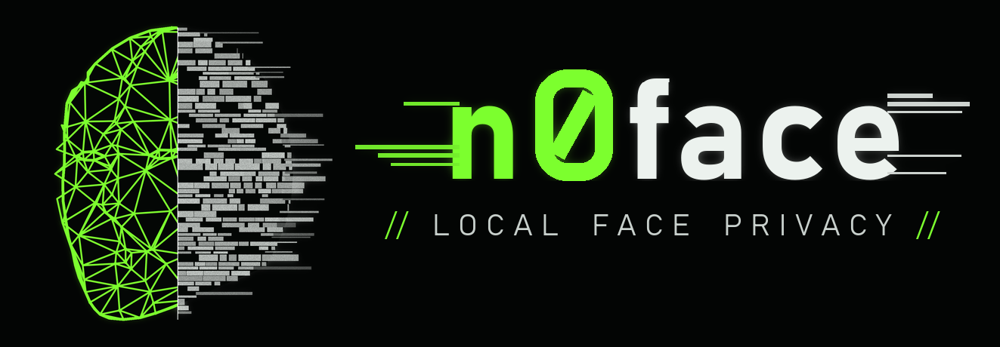

# n0face



Local-only face masking and anonymization for your webcam. n0face finds your face, replaces it
with generated content, and publishes the result as a **virtual camera** that Discord, Teams,
Zoom, OBS, Meet and other apps can use.

- **On-device.** Detection runs locally (MediaPipe). No cloud, no accounts, no telemetry.
  Python-level networking is switched off while the app runs.
- **Replacement, not blur.** Masked regions are generated from scratch, not filtered from your
  face pixels (the one exception, `pixelate`, is labeled as the weakest option).
- **Fail-closed.** If face tracking drops for more than a few frames, the whole frame is hidden
  until your face is found again.
- **No recording.** Live camera frames are never written to disk. The only files n0face
  writes are the masked copies of photos and videos you explicitly ask it to process.

## Privacy modes

Be clear about what each mode does. **No mode makes you unidentifiable.** Your body, voice,
clothing, room and behavior can all identify you.

| Mode | What it does | What it does NOT protect |
|---|---|---|
| `mask` | Stylized LED or wireframe mask with a scanner HUD. | **Decorative.** It renders your facial geometry and expressions, which are themselves identifying. |
| `obfuscate` | Replaces face pixels with glitch blocks or static (or pixelation, the weakest option). | Face outline, hair, ears, body, voice, background. |
| `anonymize` | Covers the whole head with a shape-hiding ellipse, renders no geometry and holds the cover longer on dropouts. | Body, voice, background, gait, anything said on camera. |

The virtual camera output works in every mode.

Measured performance and failure rates go in [docs/BENCHMARKS.md](docs/BENCHMARKS.md). The data
flow and threat model are in [docs/PRIVACY.md](docs/PRIVACY.md).

## Install (Windows installer)

**[Download the latest installer from Releases](https://github.com/kaloyanstefanov66/n0face/releases/latest)**
(`n0face-setup-<version>.exe`), run it, and launch **n0face** from the Start Menu. The installer
isn't code-signed yet, so Windows SmartScreen may warn you: click **More info → Run anyway**, or
first check the SHA-256 listed in the release notes. You can also build it yourself with
`packaging\build.ps1` (see Development). It installs per-user (no administrator prompt), bundles
the face model (so nothing is downloaded), and has a normal uninstaller.

To use n0face as a camera in Discord, Teams, Zoom or OBS, also install **OBS Studio**: it
provides the virtual camera driver n0face publishes through (OBS doesn't need to be running).
Everything else, including the masked preview and photo/video processing, works without it.

## Install (Windows, from source)

Requirements: Python 3.11+ and a webcam. OBS Studio is optional (virtual camera only, as above).

```bash
git clone <this repo> n0face && cd n0face
python -m venv .venv
.venv\Scripts\pip install -e .
.venv\Scripts\python scripts/get_model.py
```

`get_model.py` downloads the 3.8 MB face landmark model once. It's the only network access
n0face ever makes.

## Run

```bash
.venv\Scripts\n0face
```

Keyboard: press **?** in the app for all shortcuts (Ctrl+O add files, Ctrl+Enter process/engage,
Esc cancel, M next mode, 1-3 effect, R reset the 3D view). Turn on **REDUCE MOTION** in the
LOOK tab to switch off transitions and idle animation; it defaults to your Windows animation
setting. Only display preferences are remembered between sessions, never file names or paths.

The window has four sidebar tabs: **SOURCE** (files or camera), **MASK** (privacy mode and
effect), **LOOK** (theme and overlay) and **SYSTEM** (status and last run). With nothing loaded,
the main screen shows an interactive 3D preview of the selected mask on a generic, anonymous
face model. Drag to rotate, scroll to zoom, double-click to reset, and hover to inspect
landmarks.

### Photos and videos you already have

Under **SOURCE**, choose **FILES**. Drop photos or videos onto the window (or click SELECT). The
main screen shows a processed preview of the selected file. Pick a mode, then press **PROCESS**. From the terminal:

```bash
.venv\Scripts\n0face-cli process photo.jpg trip.mp4 some-folder\ --mode anonymize --out masked\
```

- Each output is saved as a copy, `name.n0face.jpg` / `name.n0face.mp4`. Originals are never touched.
- **Metadata is removed:** EXIF, GPS, camera model, timestamps and video tags.
- **Audio is removed by default,** because voices identify people. `--keep-audio` (or the
  KEEP AUDIO toggle) keeps it, and the voice is not altered.
- Photos are also scanned in overlapping tiles, to catch small faces in group shots.
  `--fast` skips the tiles.
- In videos, each frame's mask also uses detections from the 4 frames on each side
  (`--window`), so brief detector misses stay covered.
- If no face is found in a photo or frame, it is **hidden**, not passed through.
  `--on-miss keep` (or unticking HIDE IF NO FACE FOUND) keeps it unmodified, and the report
  flags it.
- Supported formats: jpg, png, webp, bmp, tiff; mp4, mov, m4v, mkv, avi, webm, wmv.
  Videos come out as H.264 MP4, which needs ffmpeg on PATH. Without ffmpeg they come out as
  MPEG-4 Part 2 with no audio.

### Live webcam

Under SOURCE choose **CAMERA**, press **ENGAGE**, then in Discord, Teams, Zoom or OBS choose
**"OBS Virtual Camera"** as your camera. The preview in the app shows exactly what those apps
receive.

A headless version is also available:

```bash
.venv\Scripts\n0face-cli --mode anonymize --preview
```

## Development

```bash
.venv\Scripts\pip install -e .[dev,bench]
.venv\Scripts\python -m pytest
.venv\Scripts\python bench/perf.py --source clip.mp4 --expect-faces 1 --label "daylight, 1 face"
```

`requirements.lock` pins the exact dependency versions the tests and benchmarks were run with.

Optional GPU rendering for 3D-wrapped masks: `.venv\Scripts\pip install -e .[gpu]`.

Build the installer (needs PyInstaller and Inno Setup 6, e.g. `winget install JRSoftware.InnoSetup`):

```bash
.venv\Scripts\pip install pyinstaller
powershell -ExecutionPolicy Bypass -File packaging\build.ps1
```

This regenerates the icon and logo (`packaging/make_icon.py`), bundles the app with PyInstaller
(`dist\n0face\`), and compiles the installer (`dist\n0face-setup-<version>.exe`).

## License

AGPL-3.0-or-later. See [LICENSE](LICENSE).
